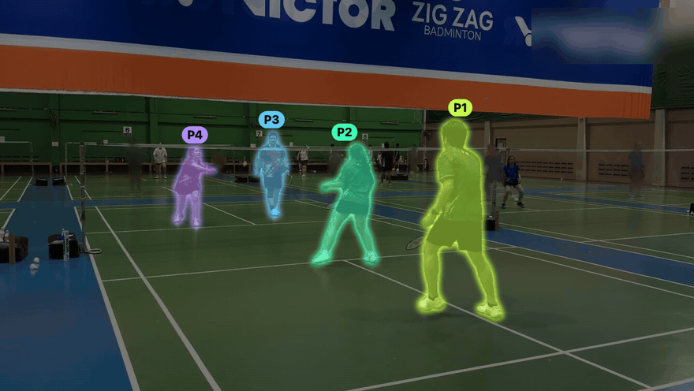

# Baddy Editor

A video editor for badminton that puts a match HUD over the footage: a title banner, a rally clock, a scoreboard for each of the four players (P1 to P4), the team score, the last shot, and a zoomed player focus inset. The players are found and followed with **Meta SAM 3.1**, so the editor can light them up, outline them and blur everyone else in the hall.

This is the open part of the Baddy Editor, made for the Meta hackathon. It runs on your machine: a small Python command talks to SAM 3.1, and the editor is a static web page.



*A doubles rally from a public Baddy Editor reel, run through this repo: SAM 3.1 segments every person in the hall and keeps their ids through the rally; the four players are tagged P1 to P4 (picked in the editor's Players panel), their masks filled, and everyone else is blurred and dimmed.*

## What it does

1. **Track** (`python -m badminton_editor track`): cuts the rally you choose, uploads it to the Meta Model API and runs SAM 3.1 once per text prompt (by default `"person"` and `"badminton racket"`). SAM returns a mask for every object in every frame, with ids that stay the same through the rally. The masks are saved exactly as SAM streamed them (`.sam`, about 25 KB per second of video).
2. **Name the players**: SAM finds everyone in the hall, including people on the next court. The four people who stay in frame longest and largest are the players; the near pair (lower in the frame) are P1 and P2, the far pair P3 and P4, left to right. Everyone else stays unnamed. You can rename anyone in the editor with one click.
3. **Edit** (`web/index.html`), per video frame:
   - **Spotlight**: dims everything except the four players.
   - **Glow outline**: a halo in each player's colour, cut from their SAM mask.
   - **Mask fill** and **name tags**: shows the segmentation itself and the P1 to P4 id each player keeps through the rally.
   - **Blur everyone else**: people on other courts and passers-by are blurred out.
   - **Extra tracks**: rackets (or any other prompt) get their own glow.
   - **HUD**: title banner, rally number and clock, shots in the rally, P1 to P4 cards (shots, smashes, winners, top speed when measured), team score with the serving side, and a last-shot ticker.
   - **Player focus inset**: a picture-in-picture that follows the chosen player, cropped from their SAM box, with their outline.
   - Two layouts. **Framed** (the default): the video sits in a gold window, P1 and P2 boards on the left, P3 and P4 on the right (points won, shots, smashes), a title banner, a bottom banner with the team score, game, rally number and clock, and the P1 focus inset in the corner. **Overlay**: the HUD drawn on the video itself, in three styles (Broadcast glass, Neon, Retro LED).
   - **Export** to a video file.

The picture and the masks always come from the same video frame (`requestVideoFrameCallback`), so outlines never lag a fast player.

## Quick start

You need Python 3.10+, ffmpeg, a Meta Model API key with SAM 3.1 access, and Chrome (or another browser that can record a canvas for export).

```bash
git clone https://github.com/Nikhi-l/badminton-editor.git
cd badminton-editor
python3 -m venv .venv && .venv/bin/pip install -r requirements.txt
cp .env.example .env        # then put your key in .env (it is git-ignored)
```

Track one rally (here 120 s to 135 s of a match video):

```bash
.venv/bin/python -m badminton_editor track my_match.mp4 --start 120 --end 135 --out rally01
.venv/bin/python -m badminton_editor inspect rally01
```

Open the editor and drop the files on it:

```bash
python3 -m http.server 8000 --directory web
```

Then open http://localhost:8000 and drop `rally01/clip.mp4`, `rally01/person.sam`, `rally01/badminton_racket.sam`, `rally01/meta.json` and a match file such as `examples/match.json`. Nothing is uploaded from the page: the video and masks stay in your browser tab.

## Cost

SAM 3.1 on the Meta Model API is billed per video frame sent, per prompt (about $0.20 per 1,000 frames when this was written). A 15 s rally at 30 fps with two prompts is 900 frames, about $0.18. `track` prints the estimate first and refuses to run above `--max-usd` (default $1). `tools/muse_hud_concepts.py` makes HUD design concepts with Meta Muse Image (`muse-image-1.0`), about $0.01 each.

## Match data (`match.json`)

The HUD only shows what the file contains. A value that is missing is left off, never invented (no km/h unless a shot carries `kmh`).

```json
{
  "title": "CIRCUIT ROYALE",
  "subtitle": "DOUBLES",
  "brand": { "name": "BADDY", "accent": "EDITOR" },
  "game": 1,
  "points_to_win": 21,
  "start_score": { "A": 12, "B": 9 },
  "start_points": { "P1": 7, "P2": 5, "P3": 6, "P4": 3 },
  "first_rally": 23,
  "players": { "P1": { "team": "A", "name": "" }, "P3": { "team": "B" } },
  "rallies": [
    { "start": 0.3, "end": 14.6, "server": "A", "winner": "A",
      "shots": [ { "t": 0.6, "by": "P1", "stroke": "serve" },
                 { "t": 3.0, "by": "P2", "stroke": "smash", "kmh": 210 } ] }
  ]
}
```

Times are seconds in the clip. The score at any moment is `start_score` plus the winners of the rallies that have ended; the side that wins a rally serves the next one. A player's **points won** is `start_points` plus the rallies their side won where they hit the side's last shot. See `examples/match.json` for a full sample (sample numbers, not a real match).

## How SAM 3.1 is used

- One request per prompt: a text noun phrase plus the uploaded video, streamed back as one line per frame (`badminton_editor/sam31.py`).
- Each line holds, per object, an id, a pixel box and a mask raster for that box, range-coded and packed in base85. `badminton_editor/codec.py` (Python) and `web/sam-codec.js` (browser) decode it.
- Masks for very large objects (a whole floor) come back capped at 1024 px on the long side, smaller than their box; both decoders scale the raster to its box.
- What works on real club footage: `"person"` finds every player, including a far doubles player that `"badminton player"` can miss; `"badminton racket"` tracks rackets; `"shuttlecock"` found nothing on our footage, so the shuttle needs a dedicated tracker.

## Layout

```
badminton_editor/   Python: SAM 3.1 client, mask codec, player naming, CLI (track, inspect)
web/                the editor: index.html, editor.js (masks + effects), hud.js (HUD), sam-codec.js
examples/           match.json sample
tools/              muse_hud_concepts.py: HUD design concepts with Meta Muse Image
docs/               the rally GIF above
```

## Not included

This repository holds the editor only. The Baddy Editor's servers, accounts, rally detection, shuttle tracking, score detection and the AI chat are not part of it; bring the score and shots in `match.json` from your own notes or detector.

## License

MIT (see `LICENSE`), except the SAM 3.1 mask decoders (`web/sam-codec.js` and `decode_mask` / `_unpack` in `badminton_editor/codec.py`), which are ports of Meta's reference decoder and are distributed under the SAM License in `SAM_LICENSE.txt`. SAM 3.1 and Muse Image are Meta models used through the Meta Model API under Meta's terms.
